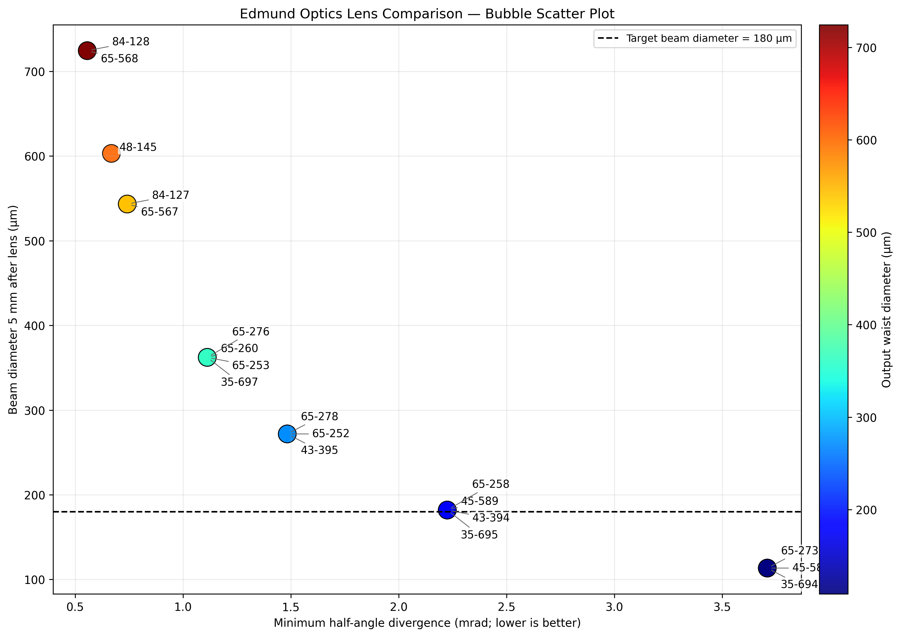

# Edmund Optics Miniature-Lens Screening


A small Python project for comparing candidate miniature lenses using an **ideal thin-lens Gaussian-beam model**. It produces a bubble scatter plot and exports the calculated results as a CSV file.

> **Important:** This is an exploratory screening tool, not a validated optical-design or ray-tracing program. Verify all lens specifications against current manufacturer datasheets. The model does not account for detailed lens prescriptions, aberrations, mechanical tolerances, or aperture clipping.

Example Result

The plot compares miniature lens candidates using an ideal thin-lens Gaussian-beam model.



X-axis: Minimum half-angle divergence (mrad)

Y-axis: Beam diameter 5 mm after the lens (µm)

Color: Modeled output waist diameter (µm)

Dashed line: Target beam diameter of 180 µm

Note: This is an exploratory screening model, not a substitute for detailed optical design or experimental validation.


## What it does

- Sweeps the lens position relative to the fiber facet.
- Estimates the output Gaussian-beam waist and half-angle divergence.
- Estimates beam diameter at a user-selected distance after the lens.
- Plots minimum modeled half-angle divergence against beam diameter.
- Colors each point by modeled output waist diameter.
- Labels candidates by Edmund Optics stock number.
- Saves a PNG plot and a CSV summary.

## Current model settings

The defaults in `lens_comparison.py` are:

- Wavelength: 633 nm
- Fiber mode-field diameter: 4.45 µm
- Maximum physical lens diameter: 2.0 mm
- Lens-to-fiber position sweep: 0.10–4.00 mm
- Beam-diameter evaluation plane: 5.0 mm after the lens
- Reference beam diameter: 180 µm

These are example project settings, not universal recommendations. Edit the constants under **USER SETTINGS** to adapt the model to your setup.

## Requirements

- Python 3.9 or newer
- NumPy
- pandas
- Matplotlib

## Run it

Install the dependencies:

```bash
python -m pip install -r requirements.txt
```

Run the script:

```bash
python lens_comparison.py
```

The script writes these files to the current working directory:

- `edmund_lens_bubble_scatter.png`
- `edmund_lens_bubble_scatter_data.csv`

## Interpreting the plot

- **X-axis:** minimum modeled half-angle divergence; lower is better for divergence alone.
- **Y-axis:** modeled beam diameter at the configured distance after the lens.
- **Color:** modeled output waist diameter.
- **Dashed line:** target beam diameter, 180 µm by default.

Do not select a lens based on one plotted metric alone. The result depends on the assumed fiber mode-field diameter, wavelength, lens position range, target plane, and simplified lens model. A low divergence does not automatically mean the beam diameter is optimal at a particular working distance.

## Lens database and attribution

Candidate specifications and product-page links are embedded in the script. Edmund Optics product availability and specifications may change. Check the current manufacturer documentation before purchasing or using any candidate in a design.

This project is an independent comparison tool and is not affiliated with or endorsed by Edmund Optics.

## License

Released under the MIT License; see `LICENSE`.
